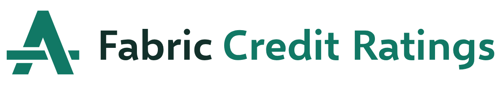

# Fabric Credit Ratings logo

The Threaded A: the top grade's letter A, with a crossbar that passes over one leg and under the other. It carries the rating and the fabric in one letter.



## Which file to use

| Use | File |
|---|---|
| Website header, documents, slides | `svg/fcr-logo-horizontal-color.svg` |
| Square or tall spaces: badges, posters, title slides | `svg/fcr-logo-stacked-color.svg` |
| Small spaces where the name is already shown | `svg/fcr-symbol-color.svg` |
| Favicon and browser icons | everything in `web/` (paste `web/head-snippet.html` into the page head) |
| Social profile picture | `social/fcr-social-avatar-1024.png` |
| Link preview image (Open Graph) | `social/fcr-og-card-1200x630.png` |
| Printer | `print/*.pdf` (vector) |
| Office apps that don't take SVG | `png/*.png` (transparent background) |

Every version comes in five colourways: `color` (green symbol, two-tone name), `green`, `ink`, `black`, and `white` for dark backgrounds. The white files use a slightly thinner drawing, because white on a dark background looks heavier than it is.

## Clear space

Keep empty space around the logo equal to **one leg of the A**, measured horizontally. That is a quarter of the A's height. Measure from the outermost point, including the ends of the crossbar. The space scales with the logo.

## Minimum size

| Version | Screen | Print |
|---|---|---|
| Horizontal | 160 px wide | 35 mm wide |
| Stacked | 96 px wide | 20 mm wide |
| Symbol | 16 px | 6 mm |

At 32 px and below, use `svg/fcr-symbol-small.svg`. It has wider gaps and a crossbar snapped to whole pixels, so it stays crisp in a browser tab. The favicons in `web/` already use it, and `web/favicon.svg` switches to Light Green when the browser is in dark mode.

## Colour

| Name | HEX | RGB | CMYK (SWOP) | Use |
|---|---|---|---|---|
| Fabric Green | `#117865` | 17 120 101 | 85 27 63 8 | Symbol, "Credit Ratings", tiles |
| Ink | `#12302a` | 18 48 42 | 10 9 9 92 | "Fabric", one-colour dark logo |
| Deep Green | `#0c5a4c` | 12 90 76 | 77 36 58 41 | Dark backgrounds for the white logo |
| Light Green | `#8ccbbb` | 140 203 187 | 45 2 27 0 | Symbol on dark interfaces |
| Pale Green | `#e6f3ef` | 230 243 239 | 11 2 6 0 | Light backgrounds |

These are the site's existing colour tokens. The CMYK values come from a profile conversion using the Windows SWOP press profile. Ask the printer to proof them. No Pantone match has been confirmed yet: choose one from a physical Pantone guide before any spot-colour job.

**Approved pairings**

- Full colour on white or Pale Green.
- White on Fabric Green, Deep Green or Ink.
- One-colour green, ink or black on white.
- On dark interfaces, use the white logo, or the symbol in Light Green.

Fabric Green on Ink fails contrast, so never put the green logo on a dark background.

| Pairing | Contrast |
|---|---|
| Fabric Green on white | 5.4 : 1 |
| Fabric Green on Pale Green | 4.7 : 1 |
| White on Fabric Green | 5.4 : 1 |
| White on Deep Green | 8.1 : 1 |
| Light Green on Ink | 7.7 : 1 |
| Fabric Green on Ink | 2.6 : 1, do not use |

## Typography

- **Wordmark:** Selawik Semibold, outlined into shapes and kerned by hand. Selawik is Microsoft's open-source stand-in for Segoe UI, released under the SIL Open Font License 1.1. Logos made from it can be used commercially.
- **Site text:** Segoe UI Variable, the site's system font. It isn't licensed for outlining into a logo, which is why the wordmark uses Selawik.
- "Fabric" is set in Ink and "Credit Ratings" in Fabric Green, matching the site's top bar.
- Never retype the name next to the symbol. Use the lockup files. The one exception is the website's top bar, which sets the name in live text beside the symbol: it stays sharp at any zoom, screen readers can read it, and the site's Segoe UI matches Selawik closely.

## Don'ts

- Don't stretch, squash, rotate or slant the logo.
- Don't recolour it outside the palette, or add gradients, shadows or outlines.
- Don't move, resize or swap the parts of a lockup.
- Don't put the green logo on dark or busy backgrounds; use the white version.
- Don't close the gaps in the crossbar. They are the idea.
- Don't add "Microsoft" to the logo. Microsoft's trademark guidelines ask other organisations not to use Microsoft marks in their logos. The site's title can still say "Microsoft Fabric Credit Ratings" in text.

## On the website

fabriccreditratings.com uses the kit:

- `public/` holds the favicons, the apple-touch and manifest icons, `site.webmanifest`, and `og-image.png` (the link preview card). They are copies of the files in `web/` and `social/`; copy them again if the artwork changes.
- All four pages link the icons in their `<head>`. The home, About and Submit scores pages also carry the link preview tags; the admin page does not.
- The top bar draws the small cut inline in `src/components/SiteNav.tsx` at 32 px, where its crossbar lands on whole pixels. On phones it shows the symbol alone.

## Handover notes

**Idea.** A credit rating's best grade starts with A, so the symbol is an A. Its crossbar is a thread: it passes over the left leg and under the right one, which makes the letter look woven. That is a quiet nod to Fabric without borrowing Microsoft's Fabric logo, which suits an independent, unofficial site.

**Construction.** The symbol is four straight-edged shapes on a 256-unit grid. The legs are 48 units wide, the crossbar 28 units tall, and every gap is 10 units measured square to the edge it cuts. The standalone symbol sits 4 units above centre, because a triangle carries its weight low.

**Lockups.** In the horizontal lockup, the name's baseline sits on the crossbar's bottom edge and its capitals are 88 units tall. The gap between symbol and name is 64 units. The stacked lockup centres the name on two lines under the symbol.

**Tests run.**

- The SVG audit scored every symbol file 99 or 100.
- The lockups scored 75 to 90. The only warnings came from the outlined type: anchor count, the i-dots as small details, and two near-level edges inside the font's own letters.
- The mark was checked at 16, 20, 24, 32, 48, 64, 96, 128 and 256 px.
- It was also checked in one colour, reversed, blurred, mirrored and rotated 180°, with no unwanted readings.
- At 16 px, the small cut keeps a two-pixel crossbar and visible gaps.

**Open items**

1. Run a trademark search before wider use. The logo was drawn from scratch and doesn't trace any known mark, but that isn't clearance.
2. Pick the Pantone match from a physical guide and proof the CMYK values with the printer.

**Rebuilding the artwork.** `source/gen.py` draws every SVG from the geometry above, and `source/exports.py` makes the PNG, social and PDF files. Both need Python 3 with fontTools and Pillow, and the Selawik font from the [1.01 release](https://github.com/microsoft/Selawik/releases/tag/1.01).

```bash
python -I source/gen.py path/to/selawksb.ttf svg
python -I source/exports.py . path/to/logo-design/scripts
```

## Folder map

```
brand/
  README.md        this guide
  svg/             master artwork: symbol, horizontal, stacked and wordmark, five colourways each
  png/             transparent PNGs at large sizes
  web/             favicon.ico, favicon.svg, PNG icons, apple-touch icon, web manifest, head snippet
  social/          profile avatar and link preview card
  print/           vector PDFs for printers (RGB; the printer converts)
  presentation/    presentation board (HTML) and its slides as PNG
  source/          scripts that rebuild everything
```
